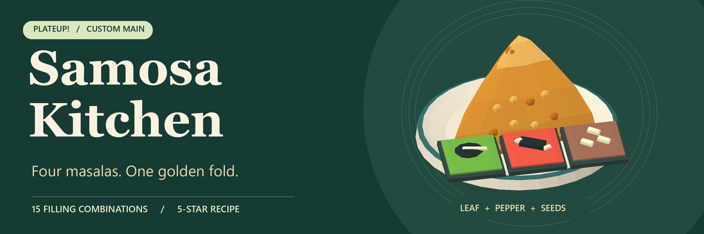
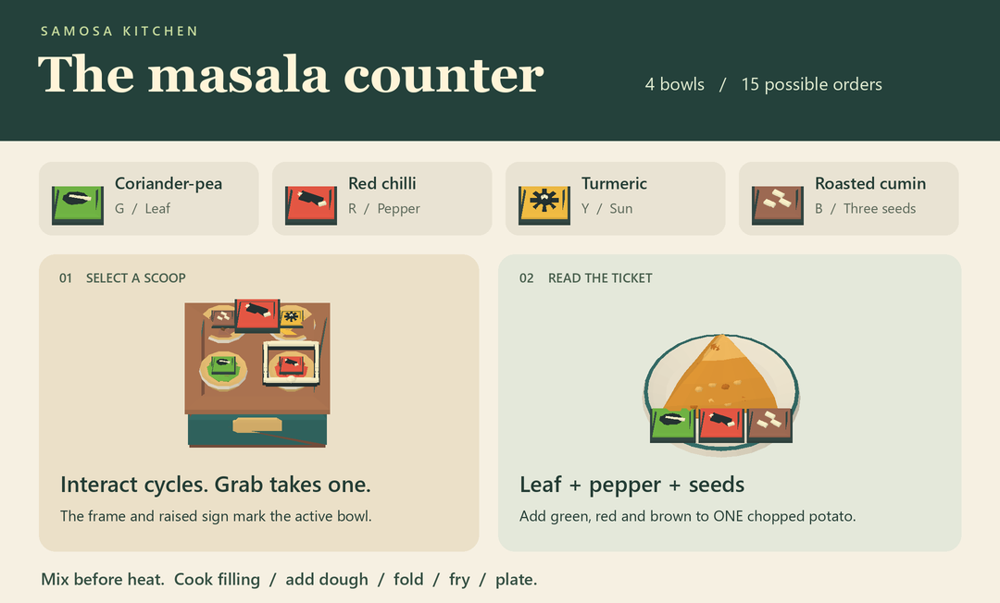
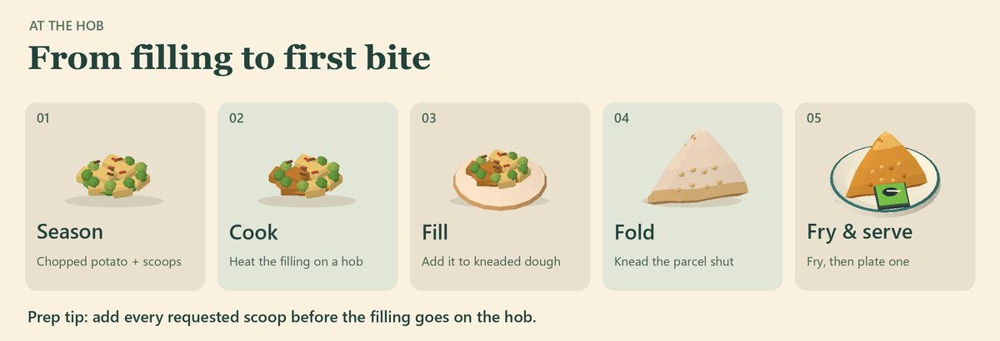

# Samosa Kitchen



**A five-star starting main for PlateUp!** Your customer orders one Indian potato samosa and picks the filling. A ticket showing a leaf, a pepper and three seeds means *one pastry with three masalas*—not three pastries. Four spice bowls make **15 possible orders**, from a single scoop to all four.

**[Download Samosa Kitchen v1.1.2 (.zip)](https://github.com/Ashesh3/plateup-samosa-kitchen/releases/download/v1.1.2/SamosaKitchen-1.1.2.zip)** · [Release notes](https://github.com/Ashesh3/plateup-samosa-kitchen/releases/tag/v1.1.2)

## Install

1. Install [KitchenLib](https://steamcommunity.com/sharedfiles/filedetails/?id=2898069883) and its required [HarmonyX](https://steamcommunity.com/sharedfiles/filedetails/?id=2898033283) dependency. The Samosa ZIP doesn't bundle either.
2. Close PlateUp!. In Steam, choose **Manage → Browse local files**. Open the folder containing `PlateUp.exe`.
3. Extract the **mod ZIP** there, **not inside `Mods`**. It already contains the folder structure below. If you're upgrading, replace the existing Samosa DLL.

   ```text
   PlateUp.exe
   Mods/
     SamosaKitchen/
       content/
         SamosaKitchen.dll
   ```

4. Launch PlateUp! and choose **Samosa** as your starting dish in HQ. For co-op, install the same mod version and dependencies on the host and each guest.

Built against **PlateUp! 1.5.3** and **KitchenLib 0.10.2** on Windows. The models are embedded in the DLL; playing doesn't require Blender, Unity Editor, or a .NET SDK.

## Read the ticket, then work the counter

Tap **Interact** to move the selection one bowl. Use **Grab** to take one scoop; grabbing leaves the selection where it is. Look for the frame around the active bowl or the raised sign above it. The station, food and ticket use the same symbols, so you don't need to distinguish the colors alone.

| Cycle | Masala | Ticket symbol |
|---|---|---|
| 1 · Green | Coriander-pea | Leaf |
| 2 · Red | Red chilli | Pepper |
| 3 · Yellow | Turmeric | Sun |
| 4 · Brown | Roasted cumin | Three seeds |



Add **one scoop of each requested masala**, in any order. Duplicate scoops won't combine, and a cooked filling can't be seasoned again. Two counters keep separate selections, which is useful when two chefs are prepping different tickets.

## Cook one order

1. **Season the potato.** Chop one potato and add the scoops shown on the ticket. Check the symbols **before** putting the mix on the hob.
2. **Cook the filling.** Heat it on a hob, then take it off. Meanwhile, knead flour into dough at a counter.
3. **Fill and fold.** Combine the cooked filling with the dough. Knead the open parcel once to seal it.
4. **Fry and serve.** Fry the folded pastry on a hob until golden. Put **one samosa on one clean plate**. Both the filling and the finished pastry can burn if left on the heat.



## Kitchen notes

- **Where's my first masala counter?** It's a required ingredient source when Samosa is on the menu. The game places it in an ingredient slot or sends an ingredient parcel if no slot is free. Once you own one, the shop *can* offer another as a random blueprint. Flour, potatoes and a clean plate stack are also requested.
- **Why can I walk through it during prep?** The counter has a solid collider like a regular ingredient crate. A prep-phase NoClip mod can intentionally let you walk through it.
- **What's new in 1.1.2?** The recipe card now reads **★★★★★ (5/5)**. Cook times, customer count, rewards and fillings are unchanged from 1.1.1.
- **Upgrading a restaurant from 1.0.x?** Existing Samosa runs can receive mixed orders after upgrading. Don't downgrade a save containing the newer fillings to 1.0.x; restore a backup from before the flavor update instead.

Want to change the recipe or inspect the models? See [building and testing](docs/DEVELOPMENT.md) or browse the [editable OBJ models](Art/obj/). The illustrations above are renders of the mod's own meshes, not game screenshots.
